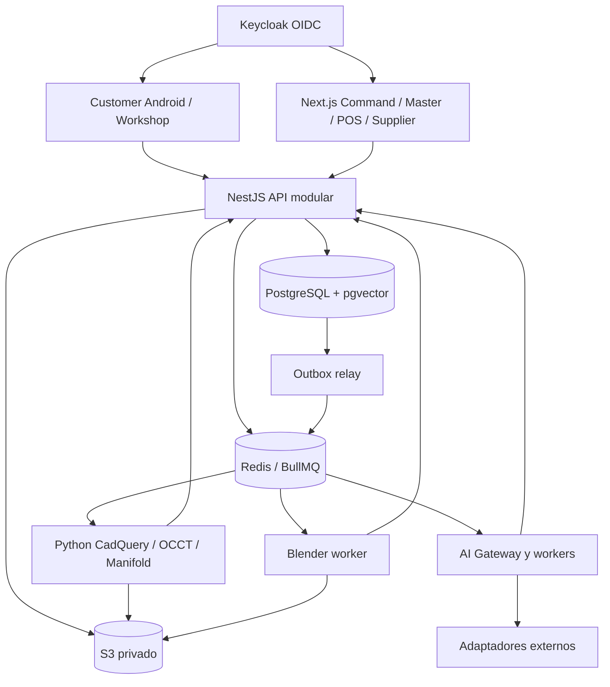

# Arquitectura lógica y física

### Límites
Core NestJS contiene identity-policy, organization, catalog, materials, design, pricing, quote, order, payment, inventory, custody, procurement, workshop, quality, CRM, finance, logistics, loyalty, document y audit. Cada módulo posee sus tablas y escribe solo mediante su servicio de aplicación. Lecturas cruzadas vía interfaz o read model. Transacciones locales abarcan invariantes necesarias; no introducir transacciones distribuidas. Workers no escriben tablas de comercio directamente: devuelven resultados con jobId, hash de entrada, versión de motor y artefactos a endpoint interno autenticado. Python usa API interna FastAPI y aislamiento por trabajo. Redis no es fuente de verdad. Object storage guarda binarios por hash, no permisos públicos.
### Flujo de regeneración
Operación validada → documento inmutable → job persistido/outbox → worker recibe snapshot → valida schema/rangos/ciclo → CAD o mesh → DFM → teselación GLB + BOM → objeto privado → resultado asociado a revisionId. Si una revisión más reciente existe, no sobrescribir su vista. Cache por hash de input + versión de kernel + tolerancias + reglas. Cancelación best effort; resultados tardíos se descartan de estado activo. WebSocket entrega eventos no autoritativos; reconectar consulta GET.
### Modelo de despliegue
Local: Compose para datos, IdP y simulación; apps host o contenedores. Demo: misma topología, datos y credenciales independientes. Staging: sandbox. Producción AWS: ALB/TLS→ECS API + workers; RDS Multi-AZ si presupuesto/criticidad lo justifican; Redis administrado; S3 privado + CDN firmada para assets; workers CAD CPU y Blender GPU en capacidad compatible, no asumir GPU en Fargate; redes privadas y roles IAM mínimos. Escalar workers por antigüedad de cola y CPU/GPU. No Kubernetes inicial. Terraform por ambiente; revisión de plan y aplicación aprobada.
### Invariantes
- Un diseño publicado tiene hash, unidad mm y versión de familia. Revisión aprobada inmutable.
- Un pago no implica liberación sin DFM, aprobación humana y materiales asignados.
- Stock no negativo, reservas expiran, gemas únicas solo una asignación activa, movimientos compensatorios.
- Las cotizaciones aceptadas congelan versión de diseño y pricing snapshot. Cambios crean una nueva propuesta.
- El cliente invitado no recibe derechos de otro proyecto al registrarse; reclamar borrador mediante token local de un solo uso.
### NFR preliminares
API lecturas p95 <500 ms bajo carga piloto a definir; 30 FPS mínimo en escena de referencia Android, 60 deseable; cambios de material <100 ms, regeneración local básica <500 ms, carga local <2 s. RPO 15 min / RTO 4 h como objetivos a negociar; no garantizados. Disponibilidad objetivo 99.5% piloto a validar. Métricas sin PII ni prompts privados. Probar degradación con proveedor caído, cámara denegada, cola saturada y red intermitente.
