# State machines
Cada transición se valida en backend con estado actual, permisos, precondiciones, versión esperada y clave idempotente. Guardas son requisitos, no código ejecutable. Estado de pedido es una proyección de máquinas independientes. Emitir evento después de persistir transición y outbox. Los estados no listados no se permiten por defecto. Cambios después de aprobación crean revisión nueva y pueden exigir compensaciones. Reembolsos parciales requieren ledger de importes; gestionar contracargos y reversión explícita.

## Design
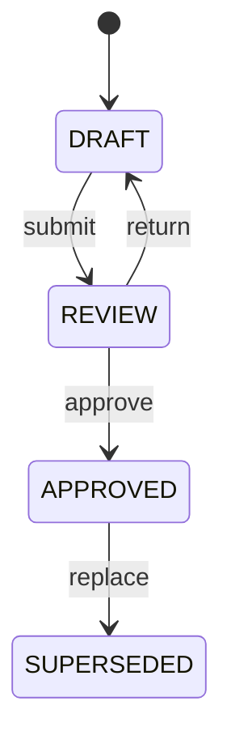

## Quote
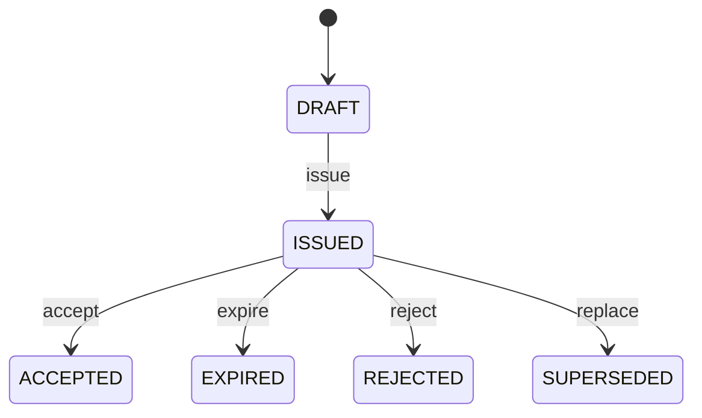

## Payment
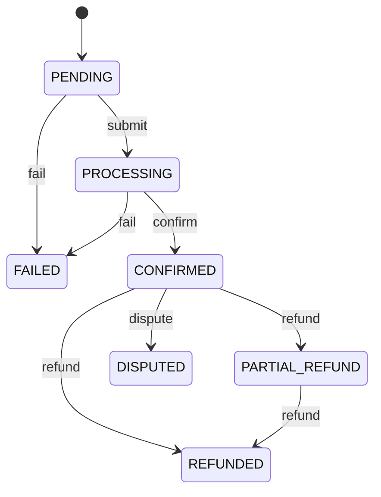

## Reservation
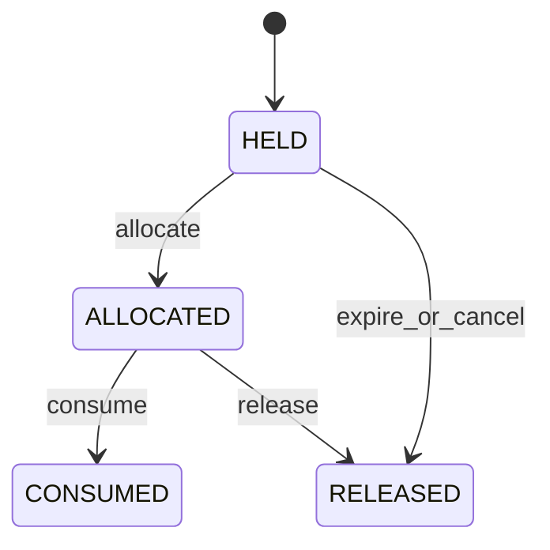

## WorkOrder
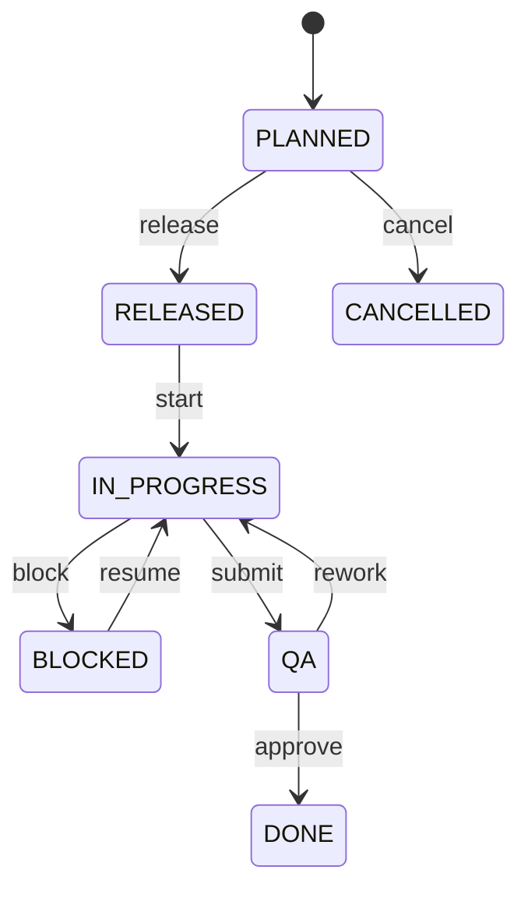

## Shipment
```mermaid
stateDiagram-v2
    [*] --> PREPARED
    PREPARED --> DISPATCHED: ship
    DISPATCHED --> DELIVERED: deliver
    DISPATCHED --> INCIDENT: incident
    INCIDENT --> DELIVERED: resolve
    INCIDENT --> RETURNED: return
```

## Certificate
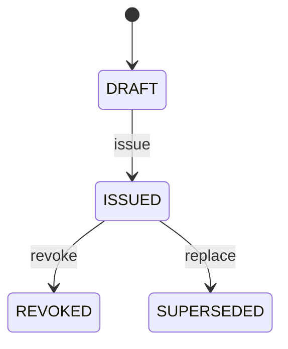

## Job
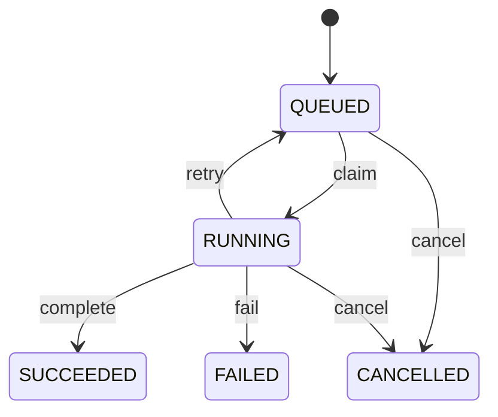

## Custody
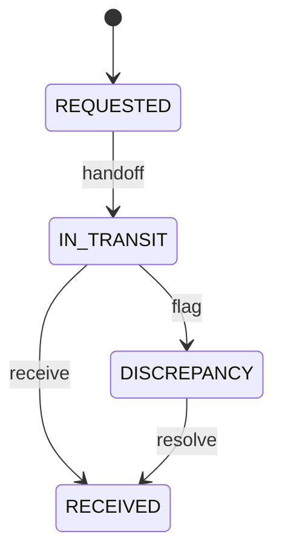

## Service
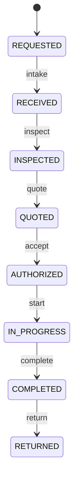

## Order
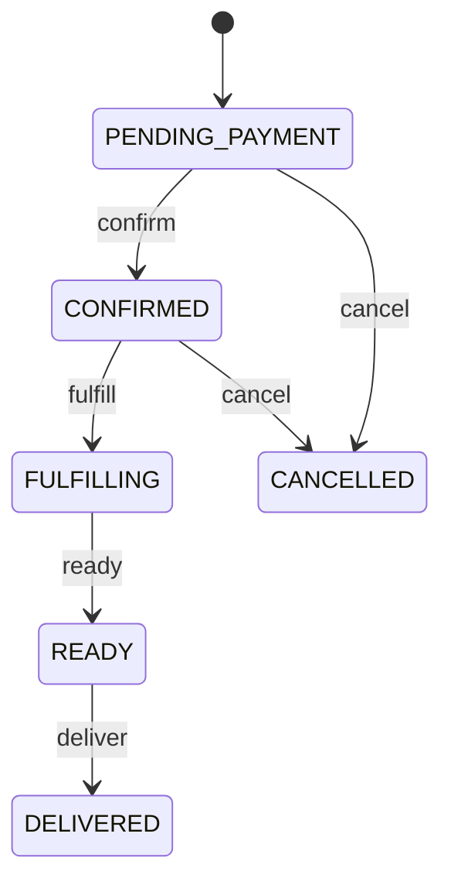

## Warranty
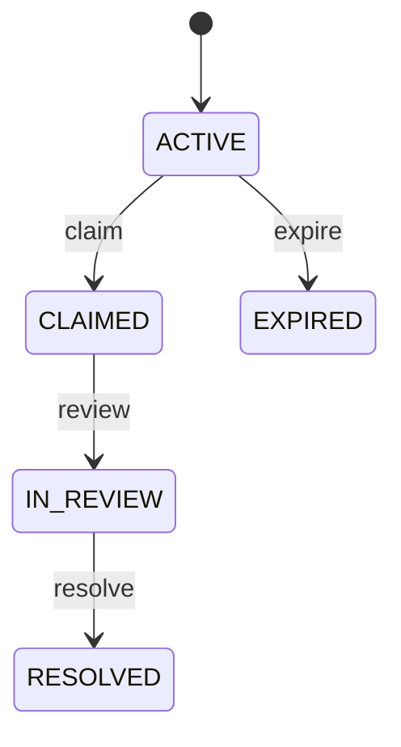

## PurchaseOrder
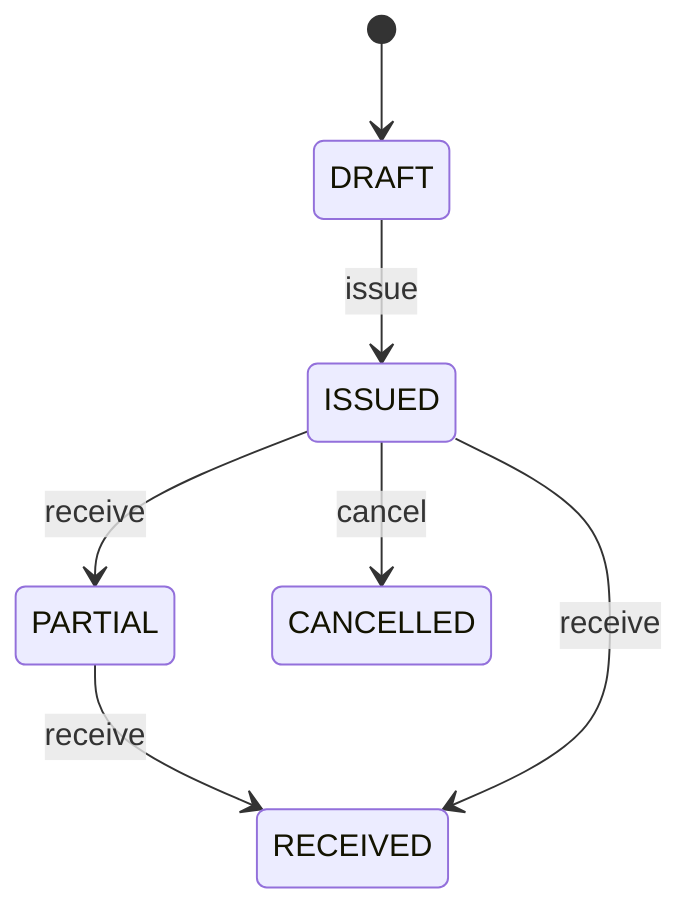
